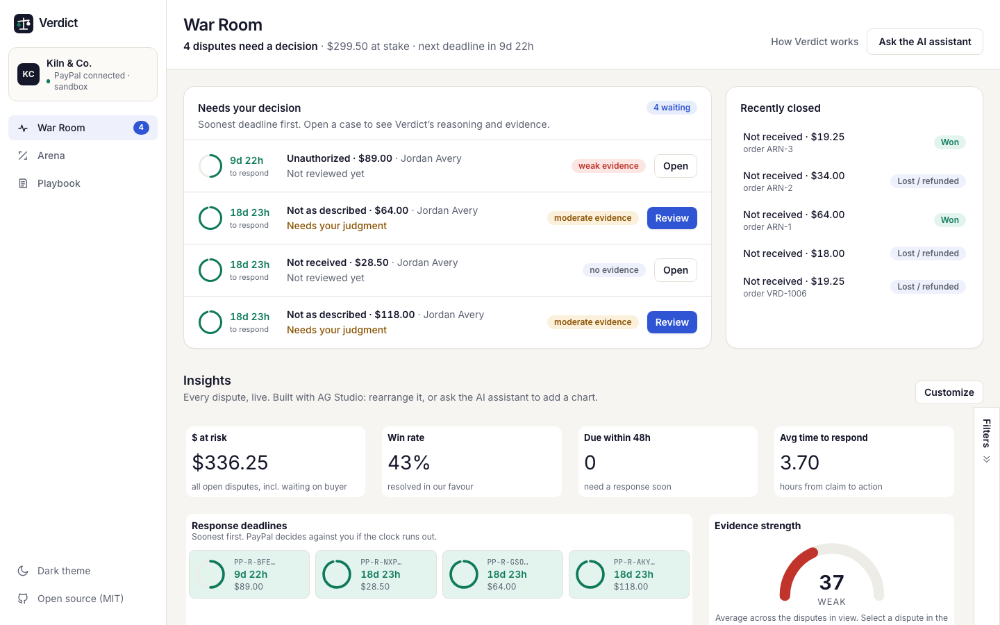
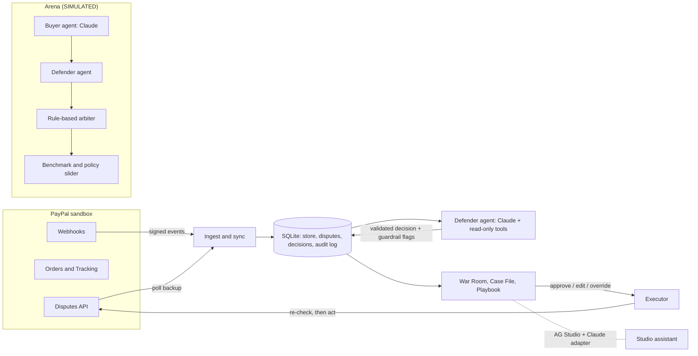

# Verdict

**An AI clerk for your PayPal disputes.** Verdict watches a small shop's PayPal disputes, tracks every response deadline, builds the case from the shop's own order and shipping records, and recommends whether to refund, make an offer or contest. The owner approves every action. An **Arena** stress-tests that strategy against simulated buyers before real ones arrive.

Built for the PayPal AI Hackathon with the **PayPal REST APIs** (sandbox), **Claude** by Anthropic, and **AG Studio / AG Grid**.

**Live demo:** [verdict-0bbi.onrender.com](https://verdict-0bbi.onrender.com) (REPLAY mode) · **Video:** [youtu.be/02pvRKyrTjg](https://youtu.be/02pvRKyrTjg) · [MIT licence](LICENSE)



## Why

Small merchants lose disputes they should win. The response window passes while they are busy, or the evidence that would win (a tracking number, a delivery scan, a listing photo) never reaches PayPal. They also pay for disputes they should simply refund, because contesting a weak case costs time and fees. Verdict does the clerk work and leaves the judgment to the owner.

## What's inside

| Screen | What it's for |
| --- | --- |
| **War Room** | The to-do list: disputes waiting on you, soonest deadline first, with Verdict's suggestion. Below it, analytics built with AG Studio, and an AI assistant (Claude through the Studio Agent Framework) that answers questions and adds charts. |
| **Case File** | One dispute: where it stands with PayPal, what Verdict recommends and why, the evidence for and against (each item cites a store record), the message to the buyer, and Approve / Edit / Do something else. "How Verdict decided" shows what the agent looked at and which checks its answer passed. |
| **Arena** | A wind tunnel. A Claude buyer agent (honest, mistaken, opportunistic or aggressive) files a dispute against a fictional order, Verdict responds, and a **SIMULATED** rule-based arbiter rules. The benchmark shows right calls by dispute type, weak spots, and money kept; a slider prices an auto-refund threshold. |
| **Playbook** | The shop's refund rules and guardrails in plain language. The agent reads the rules; the thresholds decide what is flagged for the owner. |

## How it uses PayPal

- **Disputes API** (`/v1/customer/disputes`): list and get, then the actions PayPal offers for each dispute's stage: `accept-claim`, `make-offer`, `provide-evidence` (multipart, built from the cited store records) and `provide-supporting-info`. Actions are gated by the HATEOAS links PayPal returns, and the dispute is re-fetched right before any action. Sandbox-only `require-evidence` and `adjudicate` settle test disputes.
- **Webhooks**: `CUSTOMER.DISPUTE.*` events are verified with `/v1/notifications/verify-webhook-signature` and ingested idempotently; a poller backs them up.
- **Orders v2** and **Shipment Tracking** (`/v2/checkout/orders`, `/v2/checkout/orders/{id}/track`): the demo store's real sandbox orders, with tracking attached, are what buyers dispute.
- Every call is OAuth-authenticated, retried on 5xx/429 with backoff, and logged with PayPal's debug id. Findings and sandbox quirks are in [docs/api-notes.md](docs/api-notes.md).

We call the REST API directly rather than through the PayPal Agent Toolkit: the agent has no write access at all (see below), and the writes need stage checks the toolkit doesn't make. The reasoning is in [DECISIONS.md](DECISIONS.md).

## How it uses AI

- **Defender agent** (Claude, [lib/agent](lib/agent)): investigates one dispute with **read-only tools** (the dispute, order, tracking, customer history, Playbook, evidence on file) and returns a **Zod-validated decision**: action, amount, confidence, reasoning, cited evidence, risks, and a draft message to the buyer.
- **Guardrails** check every answer before the owner sees it. The action must be one PayPal allows now, the amount can't exceed the dispute, and every evidence item must cite a real store record. Failures go back to Claude with the reason (up to 2 retries). Disputes above the Playbook's threshold, low confidence, and buyer text that tries to instruct the AI are flagged for the owner. Buyer text is wrapped as untrusted input.
- **Human approval**: the agent cannot act. The executor sends the owner's choice to PayPal and writes an **audit log** of the prompt, every tool call, every attempt and the result.
- **Buyer agent** (Claude) writes the Arena's dispute claims and replies to offers, in character.
- **AG Studio assistant**: a Claude adapter for the Studio Agent Framework ([lib/ui/claude-adapter.ts](lib/ui/claude-adapter.ts), [app/api/ai/claude](app/api/ai/claude/route.ts)) answers questions about the dashboard and builds widgets.

**Measured** (`npm run eval`, 20 labelled scenarios, SIMULATED): 95% right action, 100% routing to a human when required, 100% valid evidence citations, 100% prompt-injection resistance, about 9 s and $0.03 per dispute. Results: [fixtures/eval/latest.json](fixtures/eval/latest.json).

## The arbiter is SIMULATED

The Arena's arbiter is a **rule-based stand-in for PayPal's reviewers**, written from PayPal's published seller-protection rules. The rules are on the app's **Arbiter rules** page (`/arena/rules`) and in [docs/arbiter.md](docs/arbiter.md). It is not PayPal and doesn't predict PayPal's decisions. Arena and eval numbers measure how consistently Verdict applies the shop's rules on simulated disputes; **they are not real-world win rates**. The Arena's scenarios, the shop (Kiln & Co.), its orders and customers are fictional.

## Architecture



Next.js (App Router) and TypeScript, better-sqlite3 (seeded on first start), Zod, the Anthropic SDK, AG Studio and AG Grid, Tailwind. Tests: Vitest and Playwright with axe accessibility checks.

## LIVE and REPLAY modes

- **LIVE** (local default): talks to the PayPal sandbox and receives webhooks.
- **REPLAY** (`REPLAY_MODE=1`, used by the hosted demo): serves recorded sandbox disputes and the agent's recorded recommendations, with dates moved to today. PayPal's recorded state transitions are applied, and actions PayPal wouldn't allow are refused. Nothing is sent to PayPal. The footer says **REPLAY** on every page. The shared demo resets itself when idle; anyone can also press **Reset demo**.

## Run it

Requires Node 20 (see `.node-version`).

```bash
npm install
cp .env.example .env.local
```

**Quickest: REPLAY mode, no PayPal account needed.** Set `REPLAY_MODE=1` in `.env.local`, and add `ANTHROPIC_API_KEY` if you want the agent, the Arena and the assistant to run live. Then:

```bash
npm run dev
```

Open http://localhost:3000. The database is created and seeded on first start.

**LIVE sandbox mode.**
1. Create a sandbox REST app at developer.paypal.com and set `PAYPAL_CLIENT_ID` / `PAYPAL_CLIENT_SECRET`.
2. Run `npm run sandbox:smoke` to check the credentials and endpoints.
3. For webhooks, expose the app (for example with ngrok), register `https://<host>/api/webhooks/paypal` for `CUSTOMER.DISPUTE.*` events, and set `PAYPAL_WEBHOOK_ID`. The poller (`SYNC_POLL_SECONDS`) works without webhooks.
4. Create orders with `npm run sandbox:orders`, then file disputes against them as the sandbox buyer in the sandbox Resolution Center. The sandbox doesn't allow creating disputes by API for this account type; see docs/api-notes.md.

### Environment variables

All of them are listed with comments in [.env.example](.env.example). The main ones:

| Variable | Purpose |
| --- | --- |
| `PAYPAL_CLIENT_ID`, `PAYPAL_CLIENT_SECRET`, `PAYPAL_WEBHOOK_ID` | Sandbox REST app and webhook id (LIVE mode) |
| `ANTHROPIC_API_KEY`, `ANTHROPIC_MODEL` | Claude (default `claude-sonnet-5-5`) |
| `AG_STUDIO_LICENSE_KEY` | AG Studio licence (runs with a watermark without it) |
| `REPLAY_MODE` | `1` for recorded sandbox data |
| `DATABASE_PATH` | SQLite file, created on first start |
| `APPROVAL_THRESHOLD`, `MIN_CONFIDENCE` | Default guardrails (editable in the Playbook) |
| `ARENA_MAX_RUNS_PER_HOUR`, `ARENA_MAX_TOKENS`, `AGENT_MAX_RUNS_PER_HOUR`, … | Cost and abuse caps for a public URL |

### Commands

| Command | What it does |
| --- | --- |
| `npm run dev` / `npm run build` / `npm start` | Develop, build, serve |
| `npm test` | Unit tests (Vitest; recorded fixtures, no network) |
| `npm run e2e` | Playwright demo path on a REPLAY production build, with axe WCAG 2 A/AA checks |
| `npm run eval` | Defender evaluation on 20 labelled SIMULATED scenarios |
| `npm run arena -- --runs 10` | Run the Arena headless |
| `npm run agent -- <disputeId>` | Agent recommendation for one dispute (no PayPal action); `-- --approve <decisionId>` executes it |
| `npm run sandbox:smoke` | PayPal sandbox smoke test |
| `npm run sandbox:orders` | Create labelled sandbox orders to dispute |
| `npm run demo:orders` | Create the video's extra sandbox orders (VRD-1009 to 1011) and add their store records |
| `npm run sandbox:capture` | Save redacted dispute fixtures |
| `npm run replay:export` | Rebuild the REPLAY data from recorded sandbox disputes (`-- --rerun` re-runs the agent) |
| `npm run seed -- --reset` | Recreate the demo store |
| `npm run screens` | Re-capture the landing page's War Room screenshots from a running app |

## Sandbox notes

Disputes in this repo are real sandbox disputes on real sandbox orders, filed by hand as the sandbox buyer. Recorded responses are redacted (no ids that identify accounts, no names) and live in `fixtures/`. Sandbox behaviour that differs from the docs, such as when the settle helpers appear and where the buyer's claim text lives, is written up in [docs/api-notes.md](docs/api-notes.md).

## Project docs

[DECISIONS.md](DECISIONS.md) (decision log) · [docs/api-notes.md](docs/api-notes.md) (PayPal and AG Studio findings) · [docs/arbiter.md](docs/arbiter.md) (SIMULATED arbiter rules) · [CONTRIBUTING.md](CONTRIBUTING.md)

## Attribution

Started from PayPal's [hackathon-paypal-ag-grid-boilerplate](https://github.com/paypaldev/hackathon-paypal-ag-grid-boilerplate) (commit `5de114e`). Its Next.js setup and AG Studio example were the starting point, and its OpenAI adapter (from the AG Studio docs) was the model for our Claude adapter.

## Licence

MIT. See [LICENSE](LICENSE).
